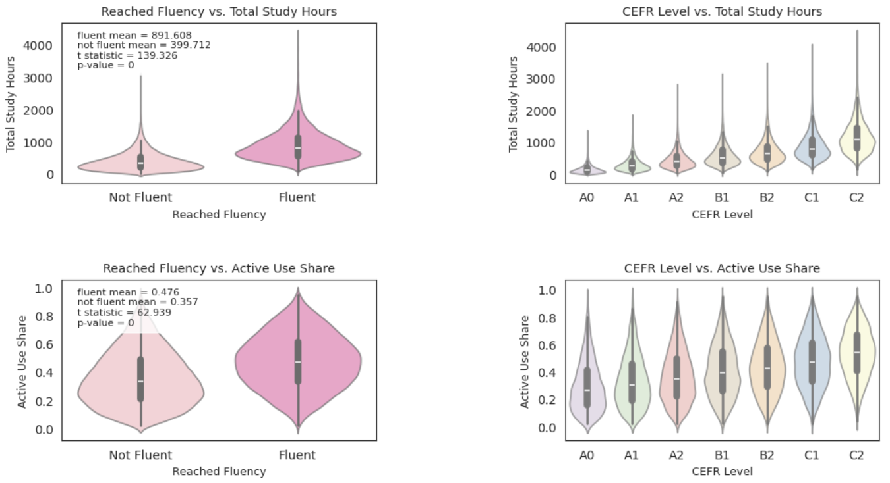
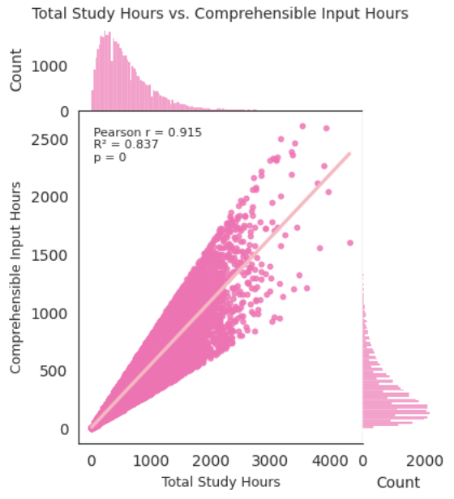
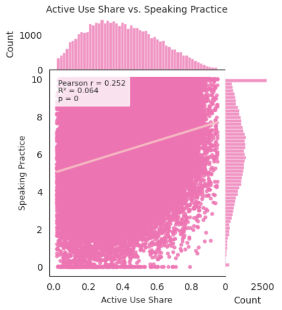
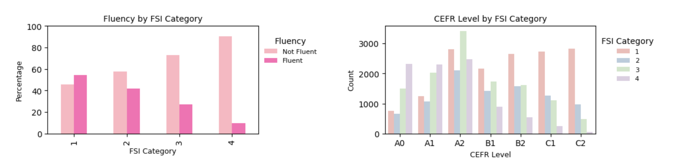
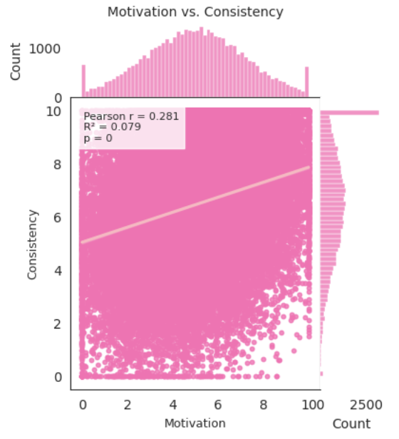
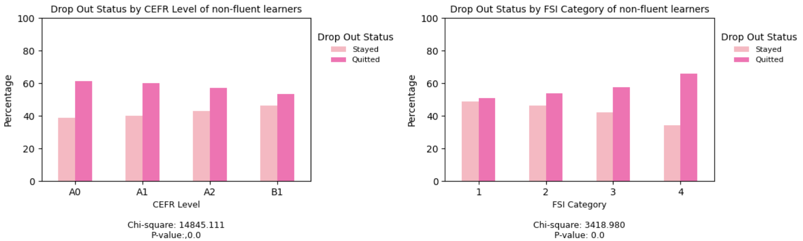
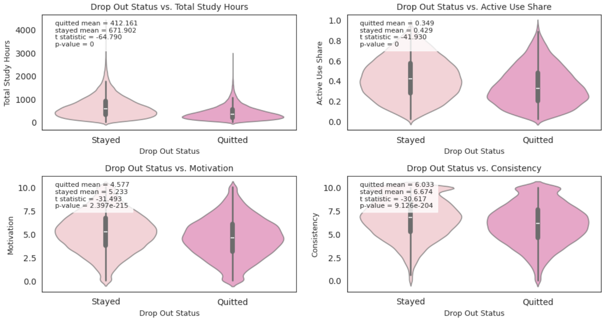
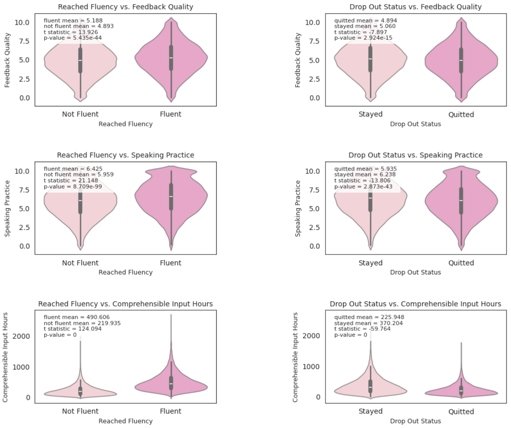
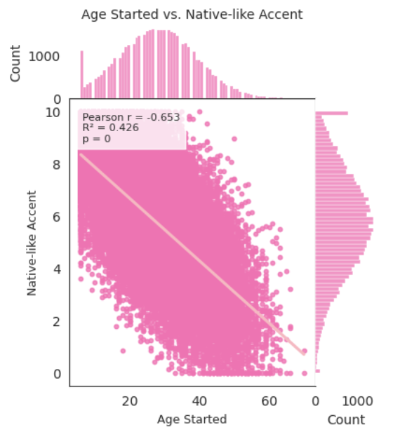

# Language Learning to Fluency: Exploratory Data Analysis

## 1. Introduction
This is a 100% synthetic Kaggle dataset generated by Sergey Nefedov.

This dataset follows 45,000 language learners to understand how they reach fluency (CEFR level B2 or above), exploring factors like the target language difficulty, motivation for language learning, study methods, etc.

## 2. Dataset Observations
Data Shape: 45,000 x 18

Examined missing values, number of unique learners, head rows of the dataframe, and summary statistics.

All **learner_id** were unique.

There were no missing data and data was clean so no data cleaning was performed.

### Data types
**binary**: related_language, uses_srs, reached_fluency, dropped_out

**categorical**: fsi_category (ordinal) and cefr_level (nominal)

**discrete numerical**: prior_languages, age_started, total_study_hours, comprehensible_input_hours

**continuous numerical**: active_use_share, immersion_months, speaking_practice, feedback_quality, motivation, consistency, accent_nativelike

### One Hot Encoding
**fsi_category** and **prior_languages** were first converted to string datatypes before one hot encoding.

**fsi_category**, **prior_languages**, and **cefr_level** were one hot encoded for to perform the correlation matrix.

### Summary Statistics

The IQR of age started is 21-35 years old, with the range being 11-70.

The median total study hours is 470 hours, which is about 5 months of studying 3 hours per day.

The median comprehensive input hours is 250 hours, 53% of the median total study hours.

The median consistency is at 7 although median motivation is at 5.

36% of the language learners are fluent in their target language.

### Data Distribution of reached_fluency, fsi_category, cefr_level, prior_languages

More learners are not fluent than fluent, at the CEFR A2 level.

Most learners are learning target language in the easiest FSI category, 1.

The distribution of **prior_languages** is right skewed (skewness = 1.1), which is expected since it is rarer to know more languages than not.

## Correlation Matrix

## 3. Research Questions
### Is studying more going to help reach fluency?

**total_study_hours** and **comprehensible_input_hours** are the two variables most positively correlated with **reached_fluency**, r = 0.55 and 0.5. **active_use_share** is the variable behind study hours that has a slight positive correlation with **reached_fluency** r = 0.28. 

There is a positive correlation trend between **total_study_hours**, **comprehensible_input_hours**, and **active_use_share** with the **CEFR Levels**. For example, **CEFR A0 level** is the most negatively correlated to **total_study_hours** and **CEFR C2 level** is the most positively correlated to **total_study_hours**.

The violin plots show that as learners become more fluent in the target language, they spend more hours studying. The means are 891.6 hours for fluent learners and 399.7 hours for non-fluent learners. The difference in study hours is huge and it is significant by two-tailed independent t test, p < 0.001.

### How are the learners studying?

**total_study_hours** and **comprehensible_input_hours** have a strong positive correlation r = 0.91.

Linear regression results show these two variables are significantly associated p < 0.001, adjusted R² = 0.837. It means that learners spend more time on input hours (as opposed to output hours) as they study more.

**active_use_share** is positively correlated with **speaking_practice** r = 0.25.

Active use has slight a positive correlation with reaching fluency and from the two-tailed independent t-test, the difference in fluent and non-fluent learners are significantly different p < 0.001, though the difference in mean is small μ = 0.476, 0.357. However, it has no correlation with **total_study_hours**.

It means that learners are not really spending as much time using the target language actively as their study hours increase, although it makes a significant difference in reaching fluency. Whenever learners actively use their target language, they are spending time in speaking practice.

### What affects reaching fluency or different CEFR Levels?

There is a negative correlation trend between fluency and FSI category and positive correlation trend between dropping out and FSI category.

For example, **FSI Category 1** is the most positively correlated to **reached_fluency** and most negatively correlated to **dropped_out**.

**FSI Category 4** is the most negatively correlated to **reached_fluency** and most positively correlated to **dropped_out**.

The left side-by-side bar chart shows fluency by FSI category. It shows the percentage of non-fluency goes up as the target language's FSI category is higher and fluency goes down as the FSI category is lower, the χ² test shows the association between **fsi_category** and **reached_fluency** are significant, p < 0.001. The right side-by-side bar chart show CEFR level by FSI category, which shows the pattern we observed in fluency in more detail. The skewness for CEFR level by FSI category goes from left skewed to right skewed as the FSI category goes up, skewness = -0.25, 0.04, 0.36, 0.80.

### Why do learners drop out?

**motivation** and **consistency** have a slight positive correlation r = 0.28 and they both have a slight negative correlation with **dropped_out** r = -0.15, -0.14.

There is a slight positive correlation between dropping out before reaching fluency (A0 - B1) r = 0.18, 0.2, 0.3, 0.14.

The side-by-side bar chart shows drop out status by CEFR level. We can see a positive trend of learner staying and negative trend of quitting as they get higher in their CEFR level. χ² test shows a significant association (p < 0.001) between **drop_out** and **cefr_level**.

The opposite trend is observed in drop out status by FSI Category. As the target language's FSI Category gets harder, more learners quitted, vice versa.

These violin plots plots variables that have slight negative correlation with **drop_out**. There is a significant difference, p < 0.001 in all variables: **total_study_hours**, **active_use_share**, **motivation**, **consistency** between the learners who stayed and who quitted. There is a 260 study hour mean difference in those who stayed and who quitted. The difference in active use, motivation, and consistency are not as drastic.

### Study methods and reaching fluency 

The means of **feedback_quality**, **speaking_practice**, and **comprehensible_input_hours** are significantly different among learners who are non fluent vs fluent and stayed vs quitted, although the difference is smaller in drop out status than reaching fluency.

### Accent

**age_started** and **accent_nativelike** have a moderate negative correlation r = -0.65. Age started is the only variable in the dataset that has a correlation with native-like accent.

### Prior Languages
The number of language a learner knows has no significant correlation with any of the variables in this dataset. The spearman correlation between **cefr_level** and **prior_languages** is r = 0.02, p < 0.001.

## 5. Discussion

The majority of language learners in this dataset are young adults, which gives them an advantage of having a native-like accent in their target language. However, having a native-like accent doesn't mean language fluency. Only 30% of the learners are fluent (CEFR Level B2 or above) with a total study hour mean = 800h. Most learners know 0 or 1 language prior to starting their study journey, but it has no correlation with any variables collected in this dataset. Not surprisingly, most learners have a good motivation and consistency - while it has nothing to do with reaching fluency, it helps learners stick with language study.

Total study hours and input hours are most correlated with reaching fluency and active use is right behind input hours in reaching fluency, it is not correlated with total study hours.

 and learners spend more than half of their study hours on comprehensive input. Although

although active use is the variable behind study hours most correlated with fluency, but sutdy hours are not correlated with active use.means active use can help with fluency and higher cefr levels but most learners spend more time on input hours.
when laerners actively use the language they are doing speaking practice. so what are the other ways?

fsi category is associated with reaching fluency and it is inc harder to reach a higher cefr level as fsi cat inc. learners also tend to drop out when the cat is higher

learners who reached fluency generally have a higher mean of feedback quality, speaking practice, and input hours.

, the mean study hours of those who quitted 340med are close to the mean study hours of non-fluent learners 330

while those who stayed are not near the mean of fluent 580medh vs 800h. fluent is b2 or above
220h diff is 3h/day for about two and half months

most learners are at a2 level then a significant drop in learners in the b1 level.

knwing prior langugaes is not really an edge maybe study methods?

## 6. Limitations
This is a synthetic dataset, variables were calculated by formula.

## 7. Next Steps
make a model to predict fluency from the observation of the eda

## 8. The secret formula to language learning
1. Start young (to have a native-like accent, although it has nothing to do with fluency)

2. Start with a low FSI Category and build confidence and study habits.

3. Put in the hours, but study smart. Spend just as much time actively studying as passively inputting the language.

4. Explore different study methods like asking for feedback, journaling, shadowing, etc.

## Note to self
- Analyze real language learner data
- gather my own data where i need to pre process and clean data
- another way to write this type of report, resize image option

  
## Resources
### Dataset
https://www.kaggle.com/datasets/sergionefedov/language-learning-to-fluency-who-gets-there

### EDA Examples:
https://www.freecodecamp.org/news/using-data-science-to-understand-what-makes-wine-taste-good-669b496c67ee
https://machinelearningmastery.com/machine-learning-in-python-step-by-step/

### One Hot Encoding for categorical variables:
https://www.kaggle.com/code/dansbecker/using-categorical-data-with-one-hot-encoding

### matplotlib and seaborn color palettes:
https://matplotlib.org/stable/gallery/color/named_colors.html
https://seaborn.pydata.org/tutorial/color_palettes.html
