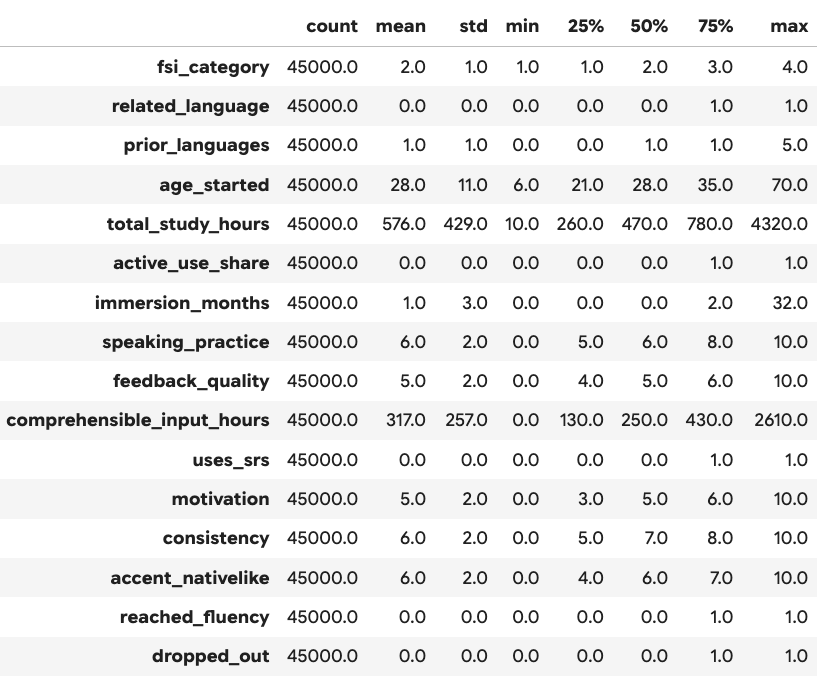
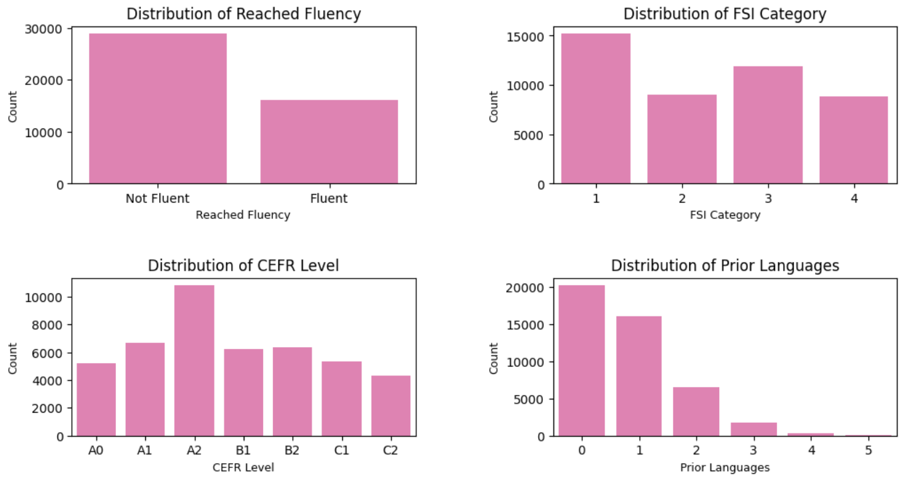
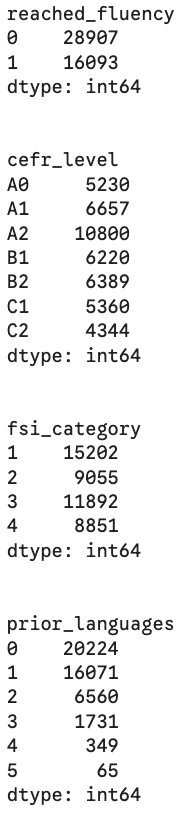
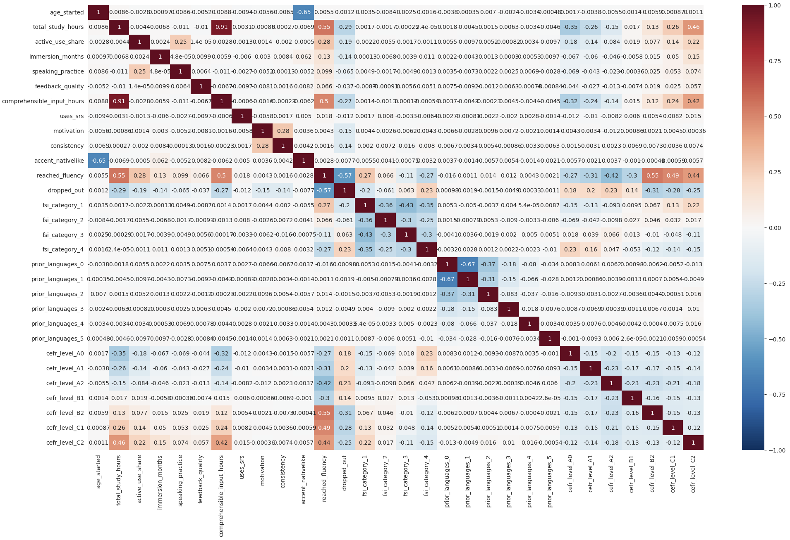

# Language Learning to Fluency: Exploratory Data Analysis

## 1. Introduction

This is a 100% synthetic Kaggle dataset generated by Sergey Nefedov.

This dataset follows 45,000 language learners to understand how they reach fluency (CEFR level B2 or above), exploring factors like the target language difficulty, motivation for language learning, study methods, etc.

## 2. Dataset Observations
Data Shape: 45,000 x 18

Examined missing values, number of unique learners, head rows of the dataframe, and summary statistics.

All learner_id were unique.

There were no missing data and data was clean so no data cleaning was performed.

### Data types
**binary**: related_language, uses_srs, reached_fluency, dropped_out

**categorical**: fsi_category (ordinal) and cefr_level (nominal)

**discrete numerical**: prior_languages, age_started, total_study_hours, comprehensible_input_hours

**continuous numerical**: active_use_share, immersion_months, speaking_practice, feedback_quality, motivation, consistency, accent_nativelike

### One Hot Encoding
**fsi_category** and **prior_languages** were first converted to string datatypes before one hot encoding.

**fsi_category**, **prior_languages**, and **cefr_level** were one hot encoded for to perform the correlation matrix

### Summary Statistics

The IQR of age started is 21-35 years old, with the range being 11-70

The median total study hours is 470 hours, which is about 5 months of studying 3 hours per day.

The median comprehensive input hours is 250 hours, 53% of the median total study hours.

The median consistency is at 7 although median motivation is at 5.

36% of the language learners are fluent in their target language.

### Data Distribution of reached_fluency, fsi_category, cefr_level, prior_languages

## Correlation Matrix

## 2. Research Questions

## 4. Exploratory Data Analysis

### 4.1 CEFR Level Distribution

Briefly describe what you found.

### 4.2 Prior Language Knowledge

Describe the relationship between prior language knowledge and CEFR.

### 4.3 Study Habits and Proficiency

Describe the relationship between study habits and CEFR.

### 4.4 Fluency and Dropout

Describe the patterns you found.

## 5. Key Findings

Summarize the most important findings from the analysis.

1. Finding one.
2. Finding two.
3. Finding three.

## 6. Limitations

Discuss limitations of the dataset and analysis.

## 7. Next Steps

Describe what you plan to investigate in the machine learning phase.

## 8. Conclusion

Summarize the main takeaways.

## Resources
### Dataset
https://www.kaggle.com/datasets/sergionefedov/language-learning-to-fluency-who-gets-there

### EDA Examples:
https://www.freecodecamp.org/news/using-data-science-to-understand-what-makes-wine-taste-good-669b496c67ee
https://machinelearningmastery.com/machine-learning-in-python-step-by-step/

### One Hot Encoding for categorical variables:
https://www.kaggle.com/code/dansbecker/using-categorical-data-with-one-hot-encoding

### matplotlib and seaborn color palettes:
https://matplotlib.org/stable/gallery/color/named_colors.html
https://seaborn.pydata.org/tutorial/color_palettes.html
